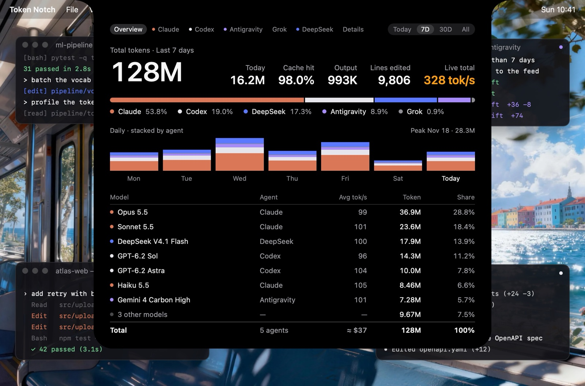
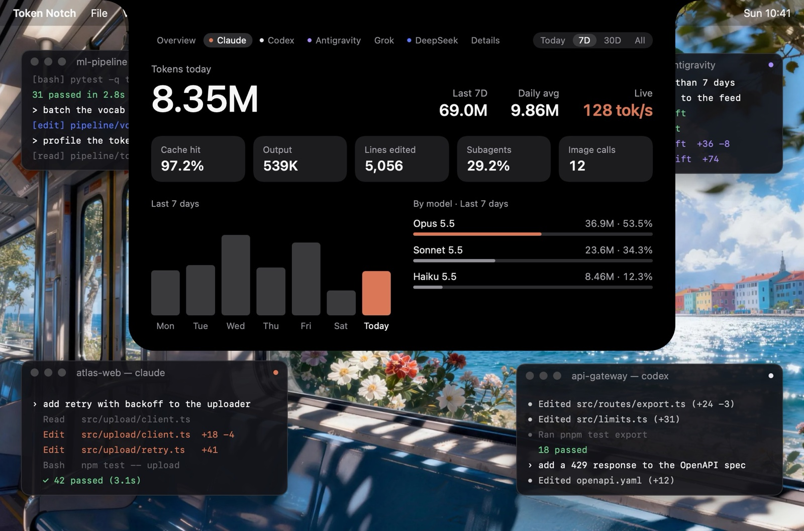
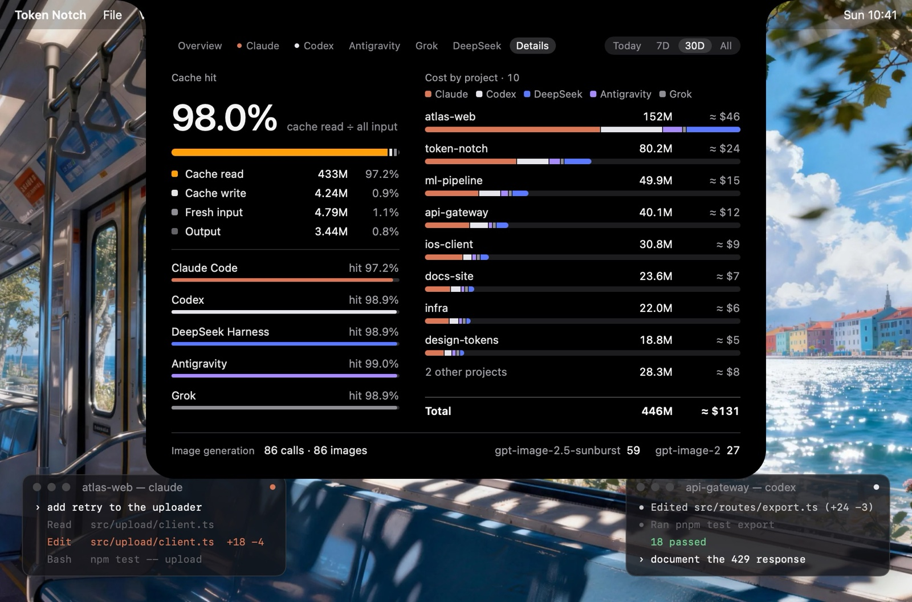
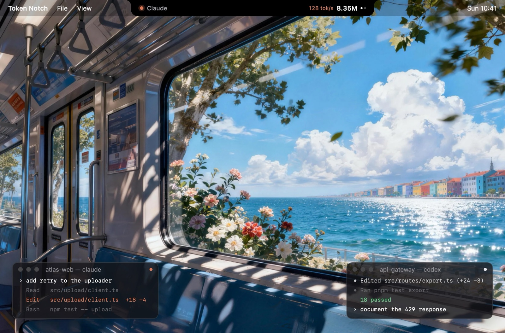

<div align="center">


# Token Notch

**A Dynamic Island for your MacBook notch that shows how many tokens your AI coding agents are burning — live.**

[](https://github.com/winbeau/token-notch/releases/latest)
[](https://github.com/winbeau/token-notch/releases)
[](#install)
[](Package.swift)
[](LICENSE)

[](#supported-agents)
[](#supported-agents)
[-A78BFA?logo=googlegemini&logoColor=white)](#supported-agents)
[](#supported-agents)
[](#supported-agents)

**[Website & live demo](https://winbeau.github.io/token-notch/)** · English · [简体中文](README.zh-CN.md)


<sub>The demo uses made-up data (`TOKEN_NOTCH_DEMO=1`); nothing from a real machine.</sub>

</div>

## Install

Download **TokenNotch-<version>.dmg** from the [latest release](https://github.com/winbeau/token-notch/releases/latest), open it, drag **TokenNotch** into **Applications**, then run this once — the app is ad-hoc signed, and macOS blocks the first launch otherwise:

```bash
xattr -dr com.apple.quarantine "/Applications/TokenNotch.app"
```

Right-click → **Open** on the first launch does the same thing. Launch at login is opt-in: right-click the notch → **开机自启 / Launch at login**; macOS lists it under **System Settings › General › Login Items & Extensions**. Every release also attaches the same app as a `.zip` and `tokens`, a command-line companion. macOS 14+, universal.

<table>
<tr>
<td></td>
<td></td>
</tr>
<tr>
<td></td>
<td></td>
</tr>
</table>

## Supported agents

| Agent | Where the logs are | Notes |
|---|---|---|
| **Claude Code** | `~/.claude/projects/**/*.jsonl` | `message.usage` on assistant lines, de-duplicated by message + request id |
| **Codex** | `~/.codex/sessions`, `~/.codex/archived_sessions` | cumulative `token_count` diffs; cached input split out |
| **Antigravity** (Gemini) | `~/.gemini/antigravity{,-cli}/brain/*/…/transcript_full.jsonl` | exact per-step counts; the model and generation time come from Antigravity's own conversation database |
| **Grok** | `~/.grok/{sessions,archived_sessions}/*/*/updates.jsonl` | per-turn usage split by model; real API duration as generation time |
| **DeepSeek Harness** | `~/.dsh/sessions/*/*/session.v4.jsonl.zstd` | appended zstd frames are decoded incrementally (needs the `zstd` command, e.g. `brew install zstd`) |

Lines edited come from Claude's Edit / MultiEdit / Write, Codex's `apply_patch`, Antigravity's `edit_file` / `write_file` and DeepSeek Harness's `edit` / `write`; failed or rejected edits are not counted.

How an edit is counted:

- **A change** is a run of consecutive added/removed lines and counts `max(added, removed)`. One call with several changes sums them.
- **Overwriting an existing file** is diffed against the previous version, so only changed lines count. Claude Code and DeepSeek Harness log the original file or the diff with the tool result. Antigravity does not, so the parser remembers the last content it saw for each file in the session (written, fully read, or edited) and diffs against that; a file it has never seen counts as new.
- **Not counted:** files under `/tmp`, `/private/tmp`, `/var/folders` and the agents' own directories (`~/.claude`, `~/.codex`, `~/.gemini`, `~/.dsh`, `~/.grok` — plans, memory, scratch); lock files, `*.min.js`, `*.min.css`, `*.map`, and anything under `node_modules`, `.build`, `__pycache__`, `.venv`, `Pods`, `DerivedData`.
- Documentation (`.md` and the like) counts like code. Image calls are `img` / `imagegen` `generate|edit` commands run through an agent's shell tool (plus a built-in `image_gen` tool if one shows up).

### Build from source

Requires Xcode 16+ (Swift 6) on macOS 14+.

```bash
git clone https://github.com/winbeau/token-notch.git
cd token-notch
./scripts/install.sh            # → /Applications/TokenNotch.app, launched, launch at login on
./scripts/build-app.sh          # → dist/TokenNotch.app and dist/tokens, without installing
VERSION=0.3.2 ./scripts/release.sh  # → dist/*.dmg, *.zip and SHA256SUMS for a release
swift test                      # parser, ingest, edit-count and migration tests
```

`scripts/install.sh --no-login` installs without touching the login item, and `scripts/install.sh --uninstall` removes both. The login item points at the installed path, so enable it after the app sits where it will stay.

## Usage

- Hover the notch to expand, move away to collapse.
- Right-click the panel: **rebuild stats** (clear `~/.tokens` and re-import), **open `~/.tokens` in Finder**, **launch at login** (checkmark), **switch language**, **quit**.
- `dist/tokens` prints every range, agent, model and project to the terminal.

### How the numbers are computed

- **Total** = fresh input + cache read + cache write + output. **Cache hit** = cache read ÷ (fresh input + cache read + cache write). Days use your local time zone.
- **Overhead.** The numbers are computed from a small per-day rollup table (day × agent × model × project); only days whose events changed are re-aggregated, range statistics are recomputed only when new data arrives, and bursts of changes to the same file are imported together every 0.5 s. On a database of 135K events a full recompute takes about 9 ms and the idle process stays under 0.2% CPU. `tokens --bench` measures it on your machine.
- **tok/s** = a response's output tokens ÷ its generation time. Antigravity and Grok record the real duration; for the others it is estimated from log timestamps (Codex's estimate includes tool time). For Claude the time runs from the request to the last content block of the response. "Live" uses the last 90 seconds.
- **Cost** uses per-model prices (default table derived from [cc-switch](https://github.com/farion1231/cc-switch)'s seed prices). Add or override models in `~/.tokens/pricing.json`:

  ```json
  {"some-model": {"input": 2, "output": 10, "cacheRead": 0.1, "cacheWrite": 2.5}}
  ```

### Debug switches

| Variable | Effect |
|---|---|
| `TOKEN_NOTCH_FORCE=expanded:overview:all` | pin a state / page / range |
| `TOKEN_NOTCH_RENDER=<dir>` | render every state to PNG (both languages) and quit |
| `TOKEN_NOTCH_LANG=en` | force English |
| `TOKEN_NOTCH_DEMO=1` | run on generated demo data instead of your logs |
| `TOKEN_NOTCH_DEBUG=hover` | log hover decisions to `~/.tokens/hover.log` (or `defaults write dev.token-notch.app debugHover -bool YES`) |

`./scripts/make-demo.sh` regenerates the demo GIF, the screenshots and an MP4 from demo data (needs `ffmpeg`).

## Project layout

```
Sources/TokenCore/     data layer: SQLite, log parsers, edit/image counting, zstd frames,
                       protobuf reader, incremental ingest, stats, pricing, FSEvents
Sources/TokenNotch/    the notch UI: window & hover zone, notch shape, wings, panel pages, strings
Sources/TokensCLI/     the `tokens` command-line tool
Tests/TokenCoreTests/  unit tests
scripts/               build-app.sh, install.sh (build + /Applications + launch at login),
                       release.sh (DMG + zips + checksums), make-demo.sh
```

## Roadmap

- [ ] Image-generation cost (by model and size)
- [ ] Lines edited for Grok (no edit-tool logs to test against yet)
- [ ] Hide while a full-screen app is in front
- [x] Launch at login (`SMAppService`)

## Acknowledgements

- Log formats and default prices were cross-checked against [cc-switch](https://github.com/farion1231/cc-switch) (MIT).
- Inspired by notch apps such as [boring.notch](https://github.com/TheBoredTeam/boring.notch); no code was copied from it (GPL-3.0).

## License

[MIT](LICENSE)
