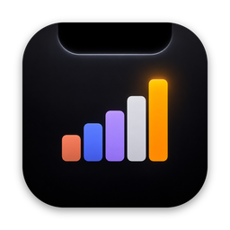
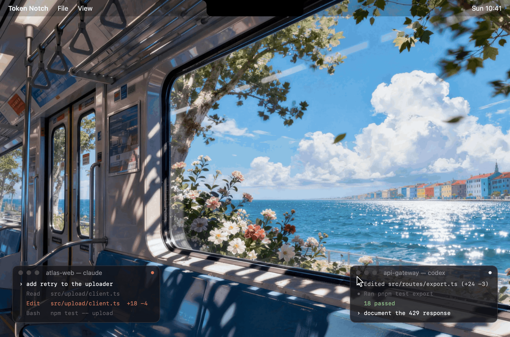
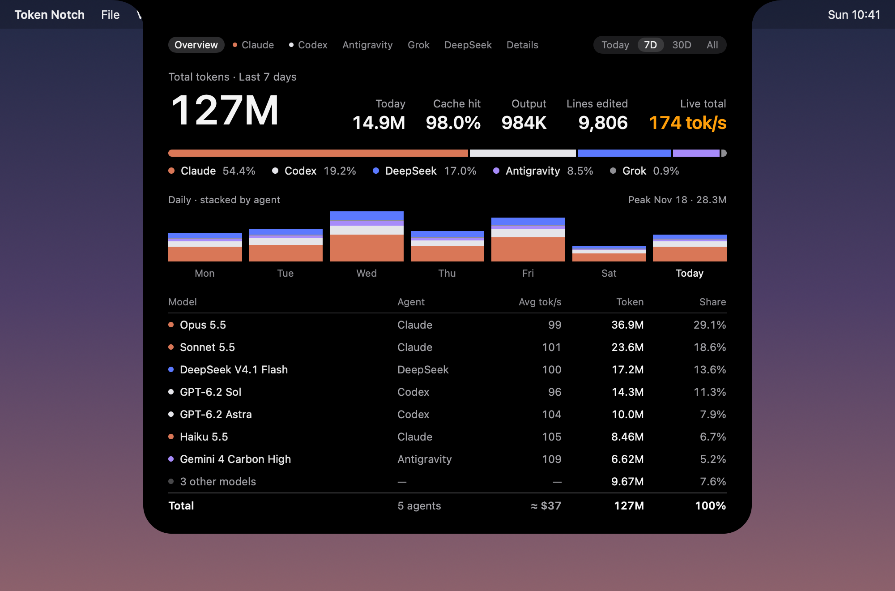
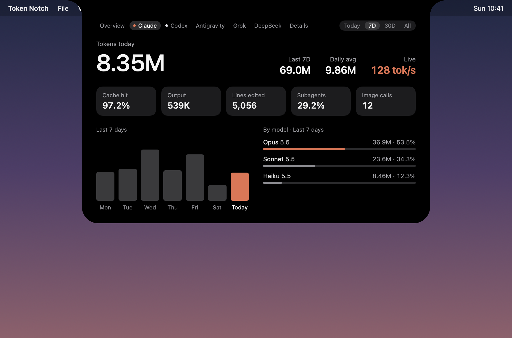
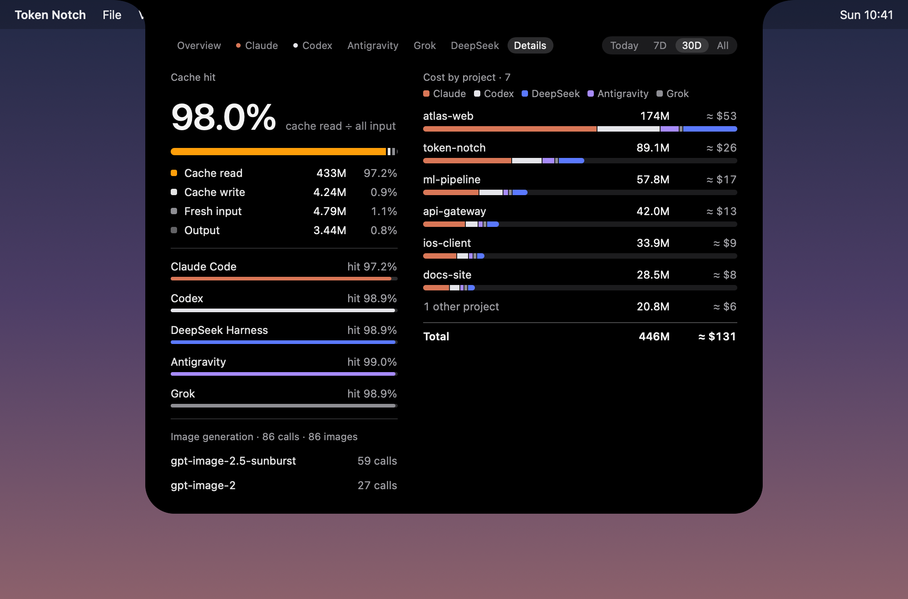
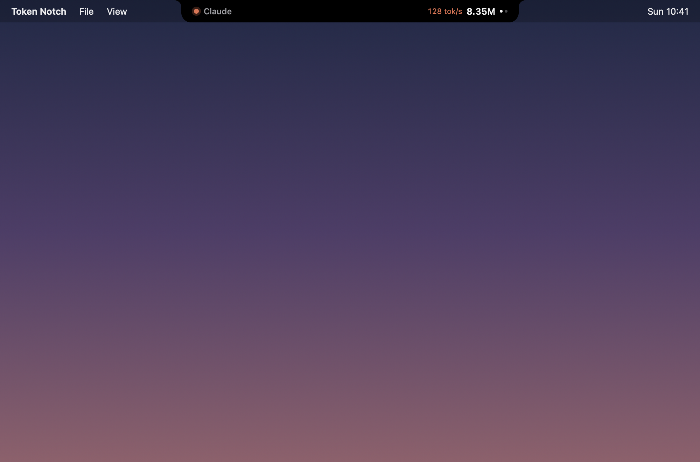

<div align="center">



# Token Notch

**A Dynamic Island for your MacBook notch that shows how many tokens your AI coding agents are burning — live.**

[](https://github.com/winbeau/token-notch/releases/latest)
[](https://github.com/winbeau/token-notch/releases)
[](#install)
[](Package.swift)
[](LICENSE)

[](#supported-agents)
[](#supported-agents)
[-A78BFA?logo=googlegemini&logoColor=white)](#supported-agents)
[](#supported-agents)
[](#supported-agents)

**[Website & live demo](https://winbeau.github.io/token-notch/)** · English · [简体中文](README.zh-CN.md)



<sub>The demo uses made-up data (`TOKEN_NOTCH_DEMO=1`); nothing from a real machine.</sub>

</div>

## Features

- **Lives in the notch.** Idle, it blends into the notch. When an agent is working, two wings slide out: the agent on the left, live **tok/s** and today's total on the right. Several agents at once cross-fade every 4 s.
- **Hover to expand.** Three pages × four ranges (Today / 7D / 30D / All):
  - **Overview** — total tokens, cache hit rate, output, lines edited, live tok/s, share per agent, daily stacked bars, per-model table with cost.
  - **Per agent** — today, range total, daily average, cache hit, output, **lines edited**, subagent share, **image-generation calls**, daily bars, model mix.
  - **Details** — cache composition, hit rate per agent, image calls per model, **cost per project** (bar length compares projects, segments split by agent).
- **Your whole history.** The first launch back-fills every log already on disk; after that FSEvents keeps it live, reading only appended lines.
- **Lines edited.** Every change counts `max(added, removed)` lines — `+1 −1` is 1, `+7 −5` and `+5 −7` are both 7.
- **Image-generation calls**, counted per model and image count.
- **Cost estimates** from a built-in price table, overridable in `~/.tokens/pricing.json`.
- **English / 中文**, switchable from the right-click menu.
- **Local only.** Reads agent logs on your Mac, writes its own SQLite database to `~/.tokens/tokens.db`. No network, no telemetry.

<table>
<tr>
<td></td>
<td></td>
</tr>
<tr>
<td></td>
<td></td>
</tr>
</table>

## Supported agents

| Agent | Where the logs are | Notes |
|---|---|---|
| **Claude Code** | `~/.claude/projects/**/*.jsonl` | `message.usage` on assistant lines, de-duplicated by message + request id |
| **Codex** | `~/.codex/sessions`, `~/.codex/archived_sessions` | cumulative `token_count` diffs; cached input split out |
| **Antigravity** (Gemini) | `~/.gemini/antigravity{,-cli}/brain/*/…/transcript_full.jsonl` | exact per-step counts; the model and generation time come from Antigravity's own conversation database |
| **Grok** | `~/.grok/{sessions,archived_sessions}/*/*/updates.jsonl` | per-turn usage split by model; real API duration as generation time |
| **DeepSeek Harness** | `~/.dsh/sessions/*/*/session.v4.jsonl.zstd` | appended zstd frames are decoded incrementally (needs the `zstd` command, e.g. `brew install zstd`) |

Lines edited come from Claude's Edit / MultiEdit / Write, Codex's `apply_patch`, Antigravity's `edit_file` / `write_file` and DeepSeek Harness's `edit` / `write`; failed or rejected edits are not counted. Image calls are `img` / `imagegen` `generate|edit` commands run through an agent's shell tool (plus a built-in `image_gen` tool if one shows up).

## Install

1. Download `TokenNotch-<version>.zip` from the [latest release](https://github.com/winbeau/token-notch/releases/latest) and unzip it.
2. Move **TokenNotch.app** to `/Applications`.
3. The app is ad-hoc signed, not notarized. On first launch macOS will refuse to open it; either right-click → **Open**, or clear the quarantine flag:

   ```bash
   xattr -dr com.apple.quarantine "/Applications/TokenNotch.app"
   ```

The release also ships `tokens`, a command-line tool that imports the logs and prints the same statistics (handy for checking numbers).

### Build from source

Requires Xcode 16+ (Swift 6) on macOS 14+.

```bash
git clone https://github.com/winbeau/token-notch.git
cd token-notch
./scripts/build-app.sh          # → dist/TokenNotch.app and dist/tokens
open dist/TokenNotch.app
swift test                      # parser, ingest, edit-count and migration tests
```

## Usage

- Hover the notch to expand, move away to collapse.
- Right-click the panel: **rebuild stats** (clear `~/.tokens` and re-import), **open `~/.tokens` in Finder**, **switch language**, **quit**.
- `dist/tokens` prints every range, agent, model and project to the terminal.

### How the numbers are computed

- **Total** = fresh input + cache read + cache write + output. **Cache hit** = cache read ÷ (fresh input + cache read + cache write). Days use your local time zone.
- **tok/s** = a response's output tokens ÷ its generation time. Antigravity and Grok record the real duration; for the others it is estimated from log timestamps (Codex's estimate includes tool time). "Live" uses the last 90 seconds.
- **Cost** uses per-model prices (default table derived from [cc-switch](https://github.com/farion1231/cc-switch)'s seed prices). Add or override models in `~/.tokens/pricing.json`:

  ```json
  {"some-model": {"input": 2, "output": 10, "cacheRead": 0.1, "cacheWrite": 2.5}}
  ```

### Debug switches

| Variable | Effect |
|---|---|
| `TOKEN_NOTCH_FORCE=expanded:overview:all` | pin a state / page / range |
| `TOKEN_NOTCH_RENDER=<dir>` | render every state to PNG (both languages) and quit |
| `TOKEN_NOTCH_LANG=en` | force English |
| `TOKEN_NOTCH_DEMO=1` | run on generated demo data instead of your logs |
| `TOKEN_NOTCH_DEBUG=hover` | log hover decisions to `~/.tokens/hover.log` (or `defaults write dev.token-notch.app debugHover -bool YES`) |

`./scripts/make-demo.sh` regenerates the demo GIF, the screenshots and an MP4 from demo data (needs `ffmpeg`).

## Project layout

```
Sources/TokenCore/     data layer: SQLite, log parsers, edit/image counting, zstd frames,
                       protobuf reader, incremental ingest, stats, pricing, FSEvents
Sources/TokenNotch/    the notch UI: window & hover zone, notch shape, wings, panel pages, strings
Sources/TokensCLI/     the `tokens` command-line tool
Tests/TokenCoreTests/  unit tests
scripts/               build-app.sh, make-demo.sh
```

## Roadmap

- [ ] Image-generation cost (by model and size)
- [ ] Lines edited for Grok (no edit-tool logs to test against yet)
- [ ] Hide while a full-screen app is in front
- [ ] Launch at login (`SMAppService`)

## Acknowledgements

- Log formats and default prices were cross-checked against [cc-switch](https://github.com/farion1231/cc-switch) (MIT).
- Inspired by notch apps such as [boring.notch](https://github.com/TheBoredTeam/boring.notch); no code was copied from it (GPL-3.0).

## License

[MIT](LICENSE)
