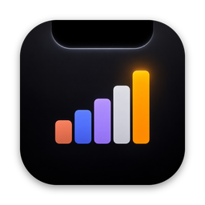
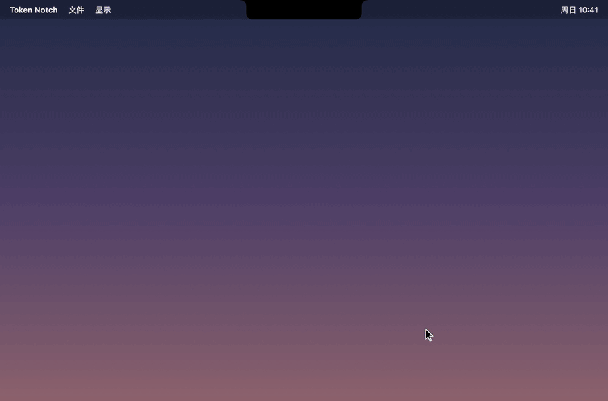

<div align="center">



# Token Notch

**macOS 刘海处的灵动岛，实时看到本机 AI 编码 agent 烧了多少 token。**

[](https://github.com/winbeau/token-notch/releases/latest)
[](https://github.com/winbeau/token-notch/releases)
[](#安装)
[](Package.swift)
[](LICENSE)

[](#数据)
[](#数据)
[-A78BFA?logo=googlegemini&logoColor=white)](#数据)
[](#数据)
[](#数据)

[English](README.md) · 简体中文



<sub>演示用的是虚构数据（`TOKEN_NOTCH_DEMO=1`），不来自任何真实机器。</sub>

</div>

## 安装

1. 从 [最新 release](https://github.com/winbeau/token-notch/releases/latest) 下载 `TokenNotch-<版本>.zip` 并解压。
2. 把 **TokenNotch.app** 移到「应用程序」。
3. 应用只做了 ad-hoc 签名、没有公证，首次打开会被 macOS 拦下：右键 →「打开」，或者清掉隔离标记：

   ```bash
   xattr -dr com.apple.quarantine "/Applications/TokenNotch.app"
   ```

release 里还有命令行工具 `tokens`，导入日志并打印同样的统计，方便对账。DeepSeek Harness 的日志是 zstd 压缩的，需要本机有 `zstd`（`brew install zstd`）。

## 功能

- **收起**：空闲时和刘海融为一体。
- **活动**：有 agent 在跑时两翼浮出——左边是 agent，右边是实时 tok/s 和今日总量；多个 agent 同时在跑时每 4 秒交叉淡入轮播。
- **展开**：鼠标移到刘海上展开面板，移开收回（展开弹簧略慢，收回更快；内容在形状张开后淡入）。顶部是标签（概览 / 各 agent / 明细）和时间范围（今日 / 7 天 / 30 天 / 全部）。
  - 概览：所有 agent 合计、编辑行数、按 agent 占比、每日柱图（按 agent 叠加）、按模型分解与合计
  - 单个 agent：今日、范围合计、日均、实时速度、缓存命中 / 输出 / 编辑行数 / 子代理占比（用过生图的 agent 多一格生图调用）、每日柱图、模型构成
  - 明细：缓存命中构成、各 agent 命中率、生图调用（按模型）、项目耗费（bar 长度按项目对比，条内按 agent 分色）
- 右键面板：重新统计、打开 `~/.tokens`、切换中文 / English、退出。
- 中英文：默认中文，右键菜单切换，存在 UserDefaults 的 `language`。时间范围、日期（11-22 / Nov 22）、星期名都跟着切换；K/M/B 与千分位两种语言一致。
- 配色：各 agent 取自 logo——Claude 珊瑚橙、Codex 近白、Antigravity（Gemini）紫、Grok 中灰、DeepSeek 鲸鱼蓝；界面强调色仍是 #FF9F0A。


## 数据

自己的库，放在 `~/.tokens/tokens.db`（SQLite）。不依赖、也不读写 cc-switch，只把它的统计口径当参考。

| 来源 | 位置 | 说明 |
|---|---|---|
| Claude Code | `~/.claude/projects/**/*.jsonl` | assistant 行的 `message.usage`；同一响应多行，按 `message.id + requestId` 去重 |
| Codex | `~/.codex/sessions/**/*.jsonl`、`~/.codex/archived_sessions` | `token_count` 的累计用量取差值；`input` 含缓存命中，入库前拆成新输入 + 缓存读 |
| Antigravity（Gemini） | `~/.gemini/antigravity{,-cli}/brain/<会话>/.system_generated/logs/transcript_full.jsonl` | `PLANNER_RESPONSE` 且 `DONE` 的步骤带精确计数。模型和生成耗时从同根目录 `conversations/<会话>.db` 原生库读（protobuf，只取需要的字段；Orchestrator 别名换成实际模型），其次取会话里的 `Model Selection`，都没有记 unknown；项目目录与子代理来自 `conversation_summaries.db` |
| Grok | `~/.grok/{sessions,archived_sessions}/<编码目录>/<会话>/updates.jsonl` | 每轮 `turn_completed` 的独立用量，按 `modelUsage` 拆模型；`inputTokens` 含缓存命中；`apiDurationMs` 当生成耗时 |
| DeepSeek Harness | `~/.dsh/sessions/*/*/session.v4.jsonl.zstd`（或 `$DSH_HOME`） | `assistant/message` 的用量（三项互不重叠）。文件是追加的 zstd 帧：自己读帧头找完整帧，只把新增帧交给本机 `zstd` 解压（没有 `zstd` 则跳过） |

格式参考了 cc-switch（MIT）的对应解析，并在本机日志上核对过。

- **回填历史**：首次启动全量导入安装前的所有日志（本机五个来源约 20 秒，其中 DeepSeek Harness 解压后约 930MB）；每导完一类 agent 就先刷新一次界面。库版本升级（v2 加编辑、v3 加生图）时会清空游标重读全部日志，用量按键去重不会重复计数。
- **实时更新**：FSEvents 监听日志目录，每个文件记字节游标只读新增的完整行；文件被改写时按指纹检测并重读，事件按键去重，重读不会重复计数。每分钟兜底扫一遍。
- **编辑行数**：每处改动记 max(新增, 删除) 行——+1−1 记 1，+7−5 与 +5−7 都记 7；一次调用里多处改动（MultiEdit、补丁的多个 hunk）逐处取 max 再相加。字符串替换按行做 LCS diff，每段连续增删算一处；整文件写入全部算新增。来源：Claude 的 Edit / MultiEdit / Write、Codex 的 apply_patch 补丁（新版包在 exec 的 JS 里）、Antigravity 的 edit_file / write_file、DeepSeek Harness 的 edit / write。Claude 和 DSH 要等工具结果没报错才算（被拒绝、匹配失败的不算）。Grok 本机没有编辑工具样本，暂不统计。
- **生图调用**：本机生图走 `img`（Codex 的 image-relay）或 `imagegen`（Claude Code 技能）命令，统计 agent 在 shell 工具里调用 `img|imagegen generate|edit` 的次数，`--help` / `--dry-run` 不算；记模型（`--model` 或 `*_MODEL=`，默认 gpt-image-2.5-sunburst）和张数（`--n`）。内置 image_gen 工具出现时也计数。
- **模型别名**：入库时统一，例如 `deepseek-flash` 记为 `deepseek-v4.1-flash`。
- **口径**：总量 = 新输入 + 缓存读 + 缓存写 + 输出；缓存命中 = 缓存读 ÷（新输入 + 缓存读 + 缓存写）。日期按本地时区。
- **tok/s**：响应的输出 token ÷（响应写入日志时刻 − 上一次用户输入 / 上一次响应时刻）。这是估算：日志里没有真正的生成耗时，Codex 的间隔还包含工具执行时间。实时速度取最近 90 秒。
- **费用**：按模型计价，默认价格取自 cc-switch（MIT）的预置价格表；`~/.tokens/pricing.json` 可覆盖或补充：

  ```json
  {"some-model": {"input": 2, "output": 10, "cacheRead": 0.1, "cacheWrite": 2.5}}
  ```

## 构建与运行

```bash
./scripts/build-app.sh          # 生成 dist/TokenNotch.app 和 dist/tokens
open dist/TokenNotch.app
dist/tokens                     # 命令行：导入并打印各时间范围的统计（对账用）
swift test                      # TokenCore 单元测试
```

调试开关：
- `TOKEN_NOTCH_FORCE=expanded:overview:all`：固定在某个状态 / 页面 / 时间范围。
- `TOKEN_NOTCH_RENDER=<目录>`：首次扫描完成后把各状态离屏渲染成 PNG（中英文各一套）然后退出。
- `TOKEN_NOTCH_LANG=en`：临时用英文界面。
- `TOKEN_NOTCH_DEMO=1`：用生成的演示数据运行（虚构项目名和用量），不读本机日志；`./scripts/make-demo.sh` 用它重新生成演示 GIF、截图和 MP4（需要 ffmpeg）。
- 悬停诊断：`TOKEN_NOTCH_DEBUG=hover`，或 `defaults write dev.token-notch.app debugHover -bool YES` 后重开应用；判定变化写到 `~/.tokens/hover.log`（来源 global / local / poll、坐标、热区、是否顶到屏幕上沿）。

悬停判定：鼠标位置来自全局 / 本地鼠标移动监听，外加轮询兜底（鼠标在刘海附近 60Hz，其余 6Hz），鼠标停住不动或事件被别的窗口吃掉也能判定。热区上沿不设限——鼠标顶到屏幕最上沿时 `y` 正好等于屏幕 `maxY`，`CGRect.contains` 不含上边界，以前“往上一甩”会偶尔判成不在热区。

## 目录

```
Sources/TokenCore/      数据层：SQLite 封装、日志解析（Parsers / AgentParsers）、编辑行数、生图调用、
                        zstd 帧、protobuf 读取、增量导入、统计、计价、FSEvents 监听
Sources/TokenNotch/     刘海界面：窗口与热区、刘海形状、两翼、展开面板三页、L10n 文案表
Sources/TokensCLI/      tokens 命令行
Tests/TokenCoreTests/   解析、增量导入、编辑行数、生图、迁移、计价、格式化的测试
scripts/build-app.sh    打包 .app（ad-hoc 签名）
```

## 路线图

- [x] 悬停展开偶尔失效（热区上沿、轮询兜底）；展开 / 收回动画分开调
- [x] 代码编辑行数取代「缓存写入」格子
- [x] 中英文切换
- [x] 更多 agent：Antigravity（Gemini）、Grok、DeepSeek Harness
- [x] 生图调用次数（img / imagegen）
- [ ] 生图费用（按模型和尺寸计价）
- [ ] Grok 的编辑行数（等有编辑工具的日志样本）
- [ ] 全屏应用时自动隐藏；开机自启（`SMAppService`）

## 致谢与许可

- 日志格式和默认价格参照了 [cc-switch](https://github.com/farion1231/cc-switch)（MIT）。
- 受 [boring.notch](https://github.com/TheBoredTeam/boring.notch) 等刘海应用启发，没有复制它的代码（GPL-3.0）。

[MIT](LICENSE)
